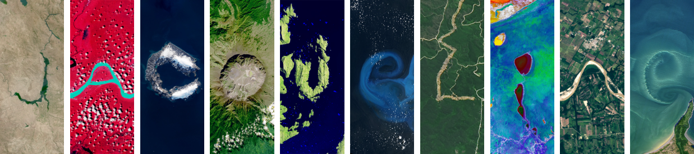

# ¡Hola👋! Soy

Estudiante de Ingeniería en Computación en ESPOL.

## Sobre mí 🥰
- Creo que cada día es una nueva oportunidad para aprender algo diferente.
- Disfruto asumir nuevos retos y participar en proyectos que me permitan crecer.
- Me interesa transformar ideas en soluciones tecnológicas útiles.

## Áreas de interés 💡

<table>
  <tr>
    <td width="60%">
      <ul>
        <li>Inteligencia artificial.</li>
        <li>Desarrollo web.</li>
        <li>Ciberseguridad.</li>
        <li>Automatización de procesos.</li>
        <li>Bases de datos.</li>
      </ul>
    </td>
    <td width="40%" align="right">
      
    </td>
  </tr>
</table>

## Habilidades y tecnologías 💻
**Lenguajes de programación y desarrollo web**
- Python
- Java
- C++
- SQL
- HTML
